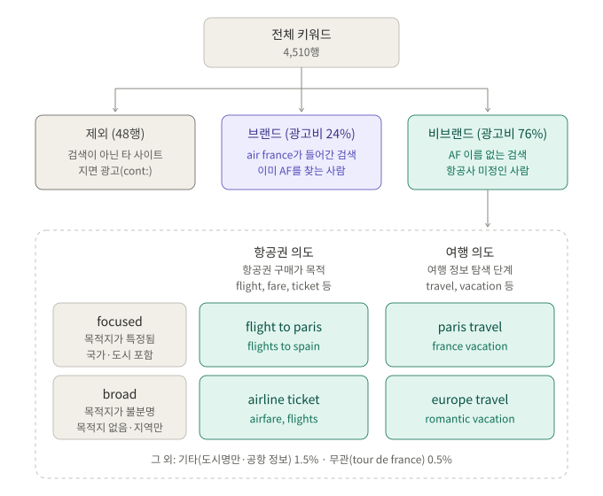

# BAIC 최종 프로젝트 · Air France 검색광고 분석

Air France 검색광고(SEM) 캠페인 성과를 진단하고, 매체·캠페인·키워드별 예산 재배분 방향을 제안하는 프로젝트입니다.

## 문제 정의

Air France는 검색광고가 흑자를 내고 있지만 클릭당 비용(CPC) 상승과 경쟁 심화로 효율 개선이 필요한 상황이기 때문에, 어떤 매체·캠페인·키워드에 예산을 늘리고 줄일지 재배분 방향과 우선순위를 정해야 한다. 이를 위해 순수익 규모(Net Revenue)와 광고비 대비 효율(ROA)을 함께 보고 판단한다.

## 폴더 구조

```
├── data/        원본 데이터와 전처리 완료 데이터
├── docs/        분류 기준 다이어그램 등 문서 자료
├── outputs/     실행 결과 (저장소에는 미포함)
└── src/
    ├── preprocess.py  전처리 (분류 컬럼 추가, 정리)
    └── eda_basic.py   1차 집계
```

## 실행

```bash
pip install -r requirements.txt
python src/preprocess.py   # data/airfrance_preprocessed.xlsx 생성
python src/eda_basic.py    # outputs/eda_basic_results.xlsx 생성
```

`outputs/eda_basic_results.xlsx`에 집계표(전체, 매체, 검색엔진, 브랜드 여부, broad/focused, 검색 의도, 캠페인, 예약 0건)가 저장됩니다.

## 키워드 분류 기준



| 단계 | 대상 | 기준 |
| --- | --- | --- |
| 제외 | Keyword가 `cont:`로 시작하는 48행 | 검색광고가 아닌 콘텐츠 네트워크 광고 |
| 브랜드 여부 | 전체 | "air france", "airfrance", 오타 "airframce" 포함 시 브랜드 |
| broad / focused | 비브랜드만 | 국가·도시·공항명이 있으면 focused, 없으면 broad |
| 검색 의도 | 비브랜드만 | 항공권 단어 또는 노선 형태면 항공권, 여행 단어만 있으면 여행 |

## 전처리 요약

| 항목 | 처리 |
| --- | --- |
| 사용 데이터 | 숨김 시트 `DoubleClick Data` (4,510행) |
| 제외 | `cont:` 48행 (콘텐츠 네트워크 광고) |
| 컬럼 삭제 | Click Charges, Keyword Type, Publisher ID, Category, Probability of Booking |
| 키워드 분류 | brand_label, scope(broad/focused), intent(항공권·여행·기타·무관) |
| 매체 | Publisher Name 7개 유지, 참고용 engine 컬럼 추가 |
| 캠페인 | campaign_group: Geo Targeted 13개 통합, Unassigned는 미지정 |
| Bid Strategy | 표기 통일, 결측은 미설정 |
| 이상치 | 삭제 없음. flag_brand_cpc_100, flag_conv_370 표시 ([최소 클릭 기준](docs/min_click_threshold.md)) |

## 지표 정의

ROA = 순수익(Amount − Total Cost) ÷ 광고비. 데이터의 `Return on Ad Dollar Spent` 컬럼과 같은 정의입니다. 매체·캠페인 단위 지표는 행별 비율을 평균내지 않고 원천 수치를 합산한 뒤 다시 계산합니다.
